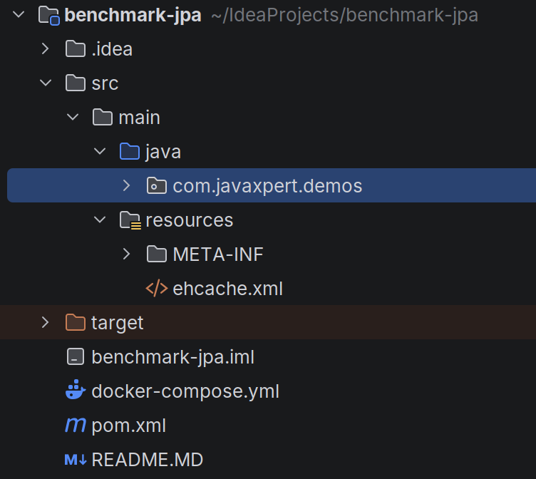
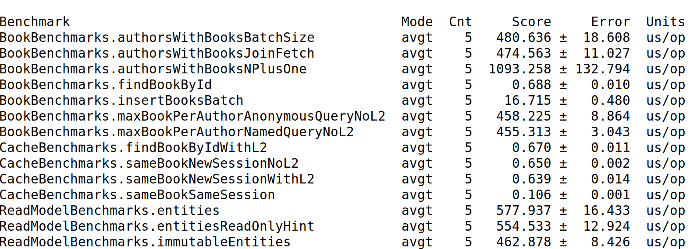

# Benchmark JPA avec JMH

## La demo

### But de la demo
Cette demo  a un double objectif:

- montrer comment realiser un micro benchmark avec JMH
- montrer (chiffres a l'appui) l'impact de certaines bonnes  pratiques JPA

### Contenu de la demo

Cette demo s'articule autour de:
- un fichier docker compose (YAML) permettant de lancer la base Postgres requise par la demo

- du code Java et des fichiers de configuration necessaires au lancement du micro benchmark




### Pre-requis 

Pour exploiter cette demo il faudra:
- maven
- docker et son plugin compose
- un JDK 25

### Lancement de la demo

Il suffit de 4 etapes:
- cloner le projet
- generer le jar executable via Maven
- lancer la base postgres via docker compose
- executer le benchmark via java

Les 3 dernieres etapes sont resumees ci-dessous:
```
mvn clean package
docker compose up -d
java -jar target/benchmarks.jar

```

### Exploitation de la demo

Une fois la commande java terminee vous obtenez dans la console un resultat proche de celui-ci (le resume de la compagne de tests de micro bencharmarking):



Ce tableau synthetise les resultats du lancement de chacun des **benchmarks** definis dans le code Java.
L'unite de temps utilisee est la micro seconde et on cherchera a obtenir des chiffres les plus bas possibles (latence moyenne).

### Details du code

#### Survol
Le projet Java comporte :
- des classes Java  (Book et Author) definies en tant qu'entites JPA
- des classes utilitaires utilisees pour montrer l'impact de l'utilisation de **DTOs**  comme le **record** AuthorBookCount
- une classe JPAState injectee dans les methodes annotees **@Benchmark** pour gerer le cycle de vie du test (remplissage et vidage de la base)
- 3 classes finissant en **Benchmarks** contenant les divers cas de test constituant le **microbenchmark**

#### Annotations JMH

JMH par le biais d'annotations et d'un *Annotation Processor* va generer une liste des  benchmarks a lancer, cette liste est mise a jour par le biais
de la commande *maven package*.

La classe BookBenchmark contient les annotations generales du micro benchmark (et propres a JMH) on les trouve ici:

```
@BenchmarkMode(Mode.AverageTime)
@OutputTimeUnit(TimeUnit.MICROSECONDS)
@Warmup(iterations = 3, time = 2)
@Measurement(iterations = 5, time = 3)
@Fork(1)
public class BookBenchmarks {
```

Donc ce benchmark mesure la **latence** , chaque test sera constitue:
- d'une phase de chauffe de la JVM (3 iterations de 2 secondes)
- de 5 executions 

Puis certaines methodes seront annotees en @Benchmark (ce sont les tests consituants notre benchmark) comme ici:

```
/** 1 query for authors + 1 lazy query per author for its books (the classic N+1). */
    @Benchmark
    public int authorsWithBooksNPlusOne(JpaState s) {
        try (EntityManager em = s.emNoL2()) {
            List<Author> authors = em
                    .createQuery("select a from Author a where a.id in :ids", Author.class)
                    .setParameter("ids", s.randomAuthorIds(AUTHORS_PER_QUERY))
                    .getResultList();
            int books = 0;
            for (Author a : authors) {
                books += a.getBooks().size();
            }
            return books;
        }
    }

```

## Bonnes pratiques JPA


Cette demo vise a  comparer diverses manieres de coder avec JPA et de quantifier  l'impact de telle ou telle strategie.

### Caches L1 et L2

Ainsi certaines methodes comparent l'impact du cache de niveau 1 (toujours active avec Hibernate) avec des codes faisant la meme chose mais sans passer par ce cache (20 requetes sur des ids seulement la derniere implementation va chercher le meme id 20 fois).

```
/**
     * One session, same id looked up REPEATS times: the first lookup goes to the database,
     * the other 19 are served by the first-level cache.
     */
    @Benchmark
    @OperationsPerInvocation(REPEATS)
    public void sameBookSameSession(JpaState s, Blackhole bh) {
        long id = s.randomBookId();
        try (EntityManager em = s.emNoL2()) {
            for (int i = 0; i < REPEATS; i++) {
                bh.consume(em.find(Book.class, id));
            }
        }
    }
```

D'autres tests montrent l'impact du cache de niveau 2 (L2) apporte ici par EhCache et sa configuration presentee ci-dessous:

```
<?xml version="1.0" encoding="UTF-8"?>
<config xmlns:xsi="http://www.w3.org/2001/XMLSchema-instance"
        xmlns="http://www.ehcache.org/v3"
        xmlns:jsr107="http://www.ehcache.org/v3/jsr107"
        xsi:schemaLocation="
            http://www.ehcache.org/v3 https://www.ehcache.org/schema/ehcache-core.xsd
            http://www.ehcache.org/v3/jsr107 https://www.ehcache.org/schema/ehcache-107-ext.xsd">

    <service>
        <jsr107:defaults enable-management="false" enable-statistics="false"/>
    </service>

    <!-- Region name = entity class name. Heap only, no expiry, large enough for the whole seed set. -->
    <cache alias="com.javaxpert.demos.Book">
        <expiry>
            <none/>
        </expiry>
        <heap unit="entries">10000</heap>
    </cache>
</config>
```
Cette *region* EhCache permet de mettre en cache jusqu'a 10000 livres et de les conserver indefiniment (*expiry* a none).

A noter une methode utitaire forcant ponctuellement l'entity manager JPA a ne pas utiliser le cache L2 :**emNoL2**

```
/** EntityManager that neither reads from nor writes to the second-level cache. */
    public EntityManager emNoL2() {
        EntityManager em = emf.createEntityManager();
        em.unwrap(Session.class).setCacheMode(CacheMode.IGNORE);
        return em;
    }
```

Divers tests vont utiliser (ou pas) le cache L2 et cette methode s'assure que celui-ci soit bien desactive quand il y a lieu.
C'est le cas ici par exemple:

```
 /** Regular managed entities: Hibernate keeps a snapshot per row and dirty-checks at commit. */
    @Benchmark
    public List<Book> entities(JpaState s) {
        try (EntityManager em = s.emNoL2()) {
            em.getTransaction().begin();
            List<Book> result = em
                    .createQuery("select b from Book b order by b.id", Book.class)
                    .setFirstResult(s.randomFirstResult(PAGE_SIZE))
                    .setMaxResults(PAGE_SIZE)
                    .getResultList();
            em.getTransaction().commit();
            return result;
        }
    }
```

### Utilisation de projections

Dans le cas de requetes de type *SELECT* il  est souvent preferable d'utiliser des *projections* ou *DTOs* a l'utilisation d'entites ceci evite des requetes de controle de coherence de l'etat de l'objet.
Un exemple de cette strategie est la requete suivante renvoyant une liste de BookView et non d'entites Book.

```
 /** @Immutable entity on a subselect: managed, but excluded from dirty checking by mapping. */
    @Benchmark
    public List<BookView> immutableEntities(JpaState s) {
        try (EntityManager em = s.emNoL2()) {
            em.getTransaction().begin();
            List<BookView> result = em
                    .createQuery("select v from BookView v order by v.id", BookView.class)
                    .setFirstResult(s.randomFirstResult(PAGE_SIZE))
                    .setMaxResults(PAGE_SIZE)
                    .getResultList();
            em.getTransaction().commit();
            return result;
        }
    }
```
Ainsi d'apres les resultats du microbenchmarks on peut noter un gain de l'ordre de 20% entre les tests ReadModelBenchmarks.entities et
ReadModelBenchmarks.immutableEntities.
A noter que plus generalement privilegier les structures de donnees immutables est une bonne pratique trop rarement suivie.


### Requetes en masse

L'exemple suivant  montre comment avec la meme structure de code que dans le cas du test *authorsWithBooksNPlusOne* on peut recuperer la liste des livres 
associes a un auteur en 1 seule requete et donc eviter le syndrome du **N+1** requetes.


```
@Benchmark
    public int authorsWithBooksBatchSize(JpaState s) {
        try (EntityManager em = s.emNoL2()) {
            List<Author> authors = em
                    .createQuery("select a from Author a where a.id in :ids", Author.class)
                    .setParameter("ids", s.randomAuthorIds(AUTHORS_PER_QUERY))
                    .getResultList();
            int books = 0;
            for (Author a : authors) {
                books += a.getBooksBatched().size();
            }
            return books;
        }
    }
```

### Conclusions

L'utilisation de ces  diverses strategies est donc a privilegier et mixer ces strategies est donc evidemment a conseiller.

## Conclusion

Voila pour cet apercu de la demonstration il est a noter que certains chiffres doivent etre challenges comme par exemple celui relatif a l'usage
de NamedQuery ou pas. 
L'ecart constate est tres faible, il pourrait etre plus important dans d'autres circonstances.

```
BookBenchmarks.maxBookPerAuthorAnonymousQueryNoL2  avgt    5   458.225 ±   8.864  us/op
BookBenchmarks.maxBookPerAuthorNamedQueryNoL2      avgt    5   455.313 ±   3.043  us/op
```
Mais meme un ecart faible de performance justifie le  fait de privilegier cette technique si l'on integre la verification de coherence 
faite a la compilation et non au runtime.
